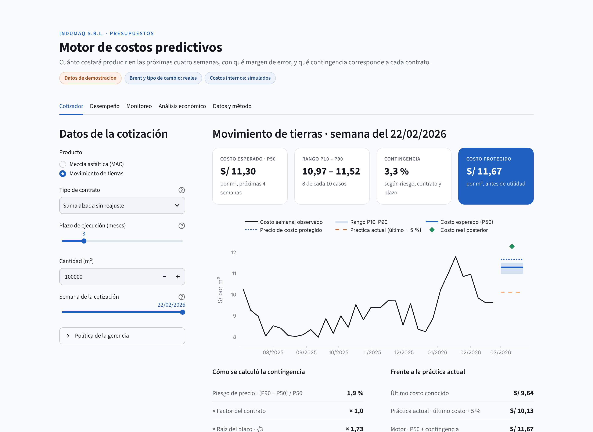

# Motor de costos predictivos

Tablero y código del proyecto **Motor de costos predictivos** (Proyecto Productivo IIIA, Instituto Continental).
Caso: INDUMAQ S.R.L., constructora vial de Arequipa.

El motor predice, con cuatro semanas de anticipación, el costo unitario de la mezcla asfáltica en caliente (S/ por t)
y del movimiento de tierras (S/ por m³). Entrega un rango (P10, P50, P90) y lo convierte en la contingencia de cada cotización.



> **Datos.** El Brent y el tipo de cambio son reales (julio de 2023 a marzo de 2026). Los costos internos son
> **simulados** con la estructura de costos de la empresa. El tablero demuestra que el método funciona; las cifras
> deben recalcularse con el historial real del ERP (pestaña *Datos y método*).

## Ejecutar el tablero

```bash
pip install -r requirements.txt
streamlit run app.py
```

Se abre en `http://localhost:8501`. No necesita GPU ni conexión a internet.

## Publicarlo gratis (Streamlit Community Cloud)

1. Suba **todo el contenido** de esta carpeta a un repositorio de GitHub. En la raíz del repositorio deben verse
   `app.py`, `requirements.txt` y las carpetas `motor_costos/`, `data/` y `.streamlit/`.
2. Entre a <https://share.streamlit.io>, elija *Create app* y seleccione el repositorio.
3. En *Main file path* escriba `app.py` y pulse *Deploy*.

## Qué tiene el tablero

| Pestaña | Para qué sirve |
|---|---|
| Cotizador | Costo esperado, rango, contingencia y precio de costo protegido según producto, contrato y plazo. Descarga el sustento |
| Desempeño | Práctica actual (último costo + 5 %) frente al motor en 54 semanas de prueba |
| Monitoreo | Alertas: cobertura móvil del rango y cambio en los datos de entrada (PSI) |
| Análisis económico | VAN, TIR y beneficio/costo con supuestos que se pueden mover; simulación de Monte Carlo |
| Datos y método | Qué es real y qué es simulado; carga del historial del ERP para recalcular todo |

## Usar datos reales

Exporte del ERP un CSV con una fila por semana y las columnas de `data/plantilla_erp.csv`
(`fecha_semana, costo_mac, costo_tierras, precio_ca, prod_mac, diesel, dist_acarreo, utilizacion, lluvia`).
Súbalo en la pestaña *Datos y método* y pulse *Recalcular con mis datos*. Se necesitan al menos 100 semanas.
`data/ejemplo_erp.csv` sirve para probar la carga.

## Estructura

```
app.py                     tablero (Streamlit)
motor_costos/              paquete del motor
  datos.py                 carga, control de calidad y generador de costos simulados
  features.py              variables explicativas
  modelos.py               catálogo de modelos
  backtest.py              evaluación semana a semana (walk-forward)
  conformal.py             calibración del rango (CQR + ACI)
  metricas.py              MAE, MAPE, Winkler, Kupiec, Diebold-Mariano, Holm, bootstrap
  contingencia.py          política de contingencia y comparación con la práctica actual
  drift.py                 monitoreo: PSI, cobertura móvil y CUSUM
  economico.py             VAN, TIR, B/C, escenarios y Monte Carlo
  servicio.py              funciones que usa el tablero
data/                      datos de mercado, resultados precalculados y plantilla del ERP
scripts/precalcular.py     regenera los resultados de data/ (unos 45 segundos)
notebooks/                 cuaderno de Colab con el experimento completo (12 modelos)
```

## Reproducir los resultados

```bash
python scripts/precalcular.py
```

Evalúa nueve modelos ligeros con semilla fija y reescribe `data/predicciones.csv` y `data/metricas.csv`.
Las redes neuronales y el modelo fundacional Chronos se evalúan en el cuaderno de `notebooks/`.

## Límites

- Los costos internos de la demostración son simulados.
- El caso base supone que el plan de obra se cumple; con un plan que falla 20 %, la mejora en tierras baja de 79 % a cerca de 38 %.
- El motor cubre el riesgo de precio y de rendimiento, no los cambios de alcance.
- El motor apoya al analista y no fija precios sin revisión humana.

Autor: Ronal Ronaldo Ccasa Lipe.
